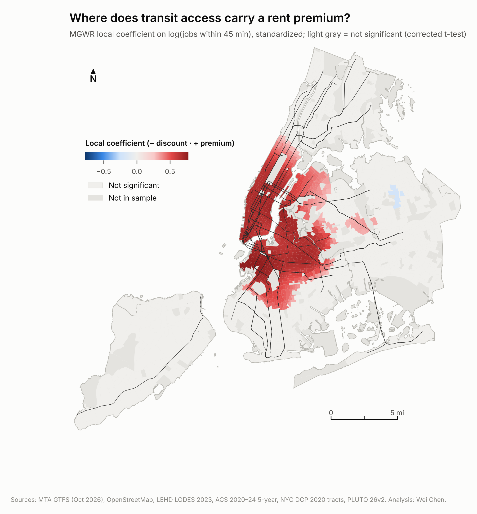
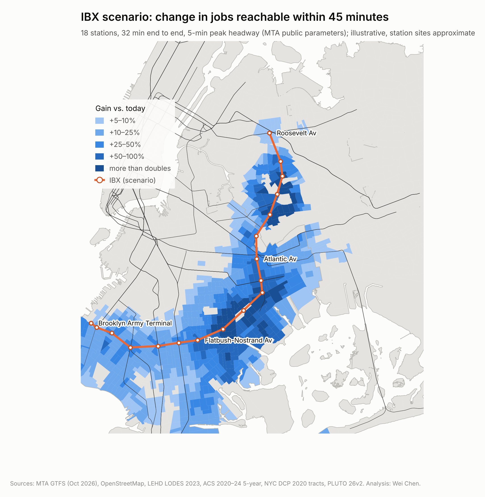
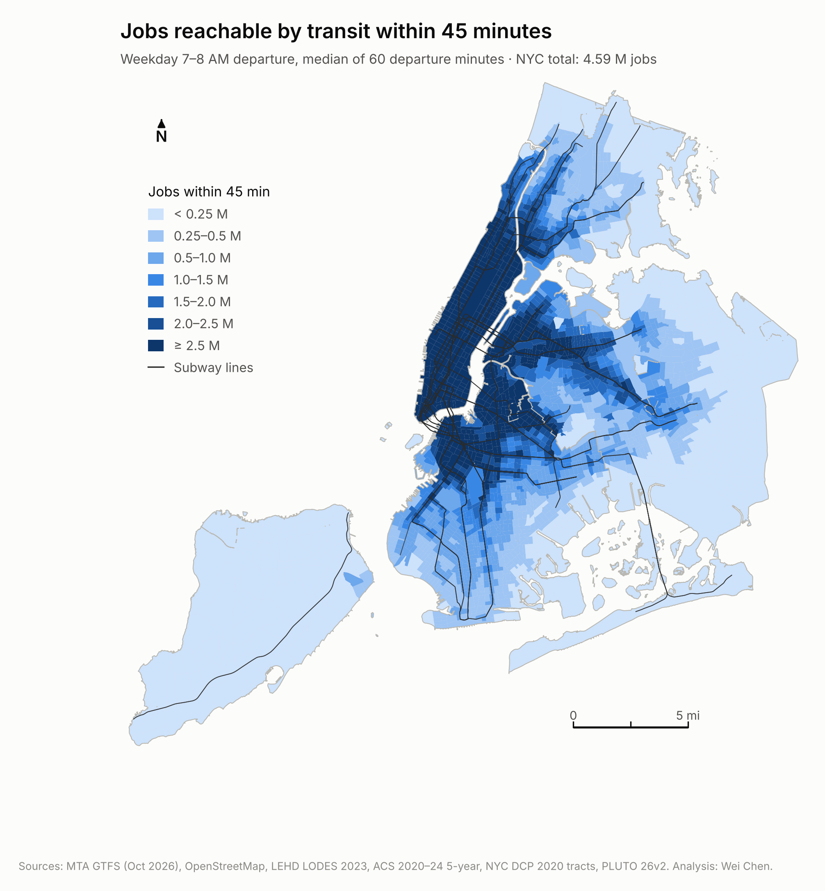
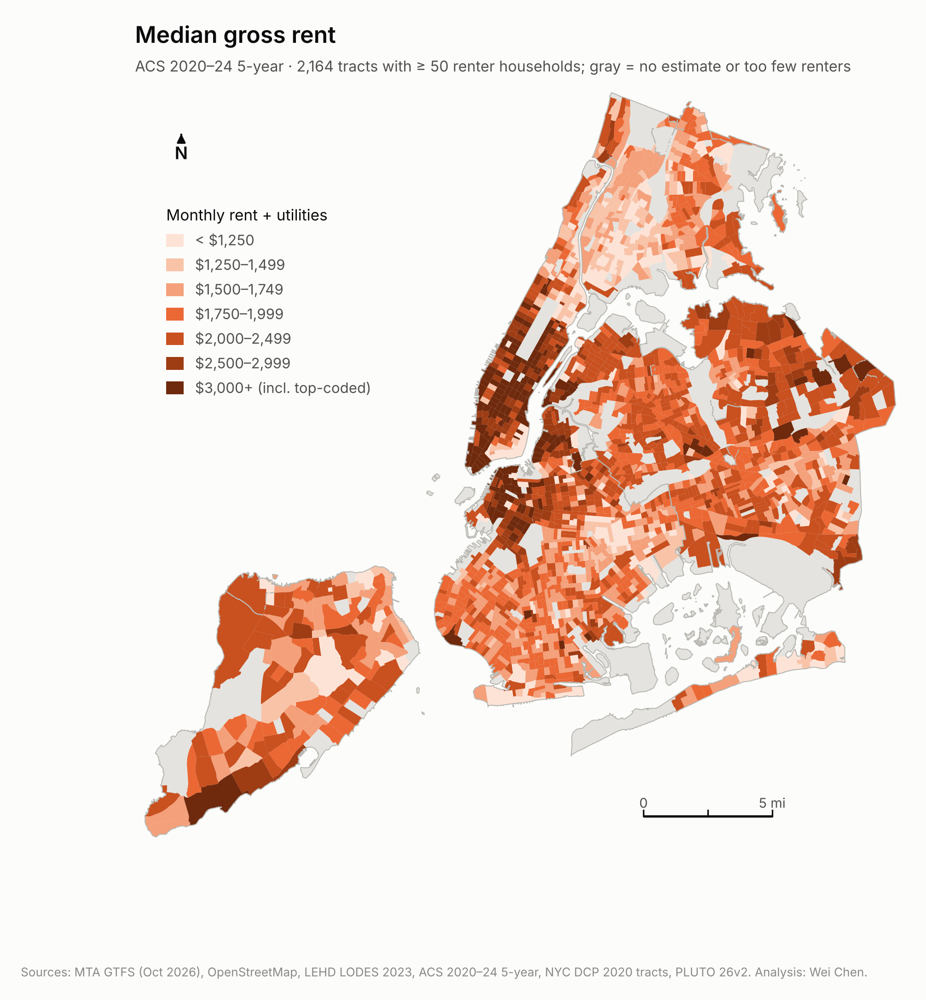
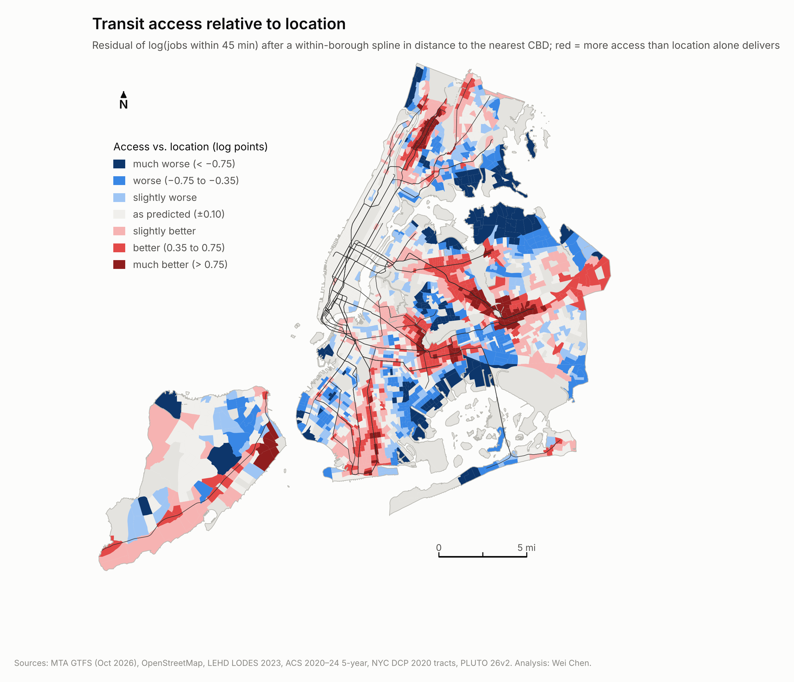
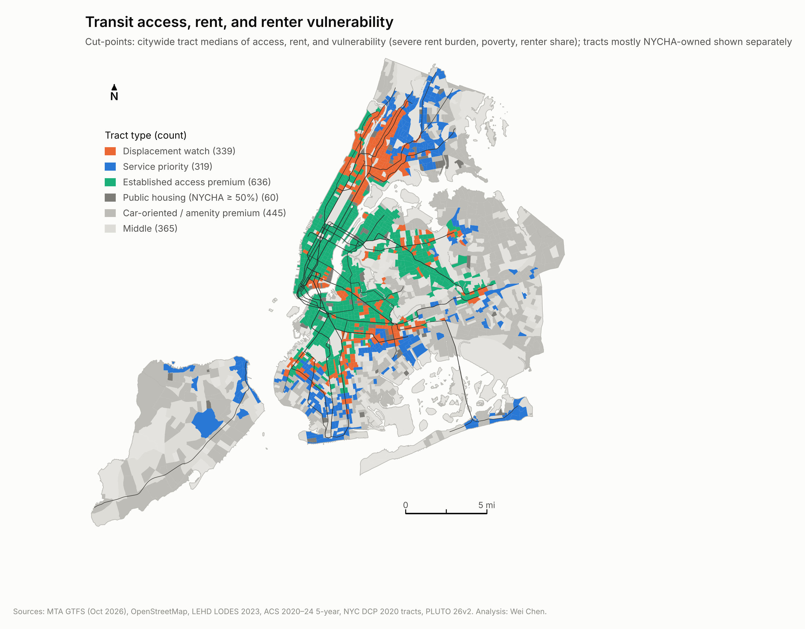
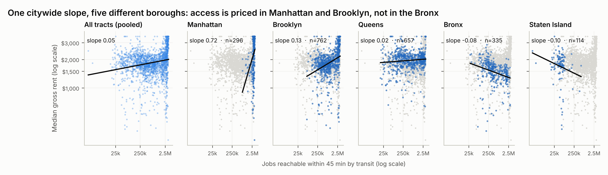
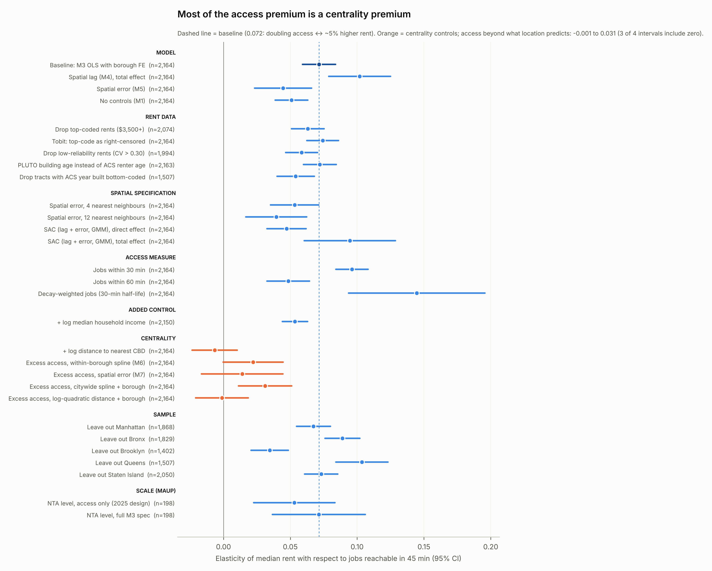

# Paying for Centrality

**Transit job access, rent, and who gains from the Interborough Express — a tract-level spatial analysis of New York City**

Wei Chen · Master of Regional Planning, Cornell University · 2026

> Independent academic work using public data.

<p align="center"> </p>

**Interactive atlas:** <!-- atlas-url -->[chesterchen2003.github.io/paying-for-centrality](https://chesterchen2003.github.io/paying-for-centrality/)<!-- /atlas-url -->

Do New York renters pay more for transit access to jobs? This project measures schedule-based transit job accessibility for every census tract, relates it to rents with hedonic and spatial econometric models, maps where the two diverge, and tests who would gain from the proposed Interborough Express (IBX).

## Findings

<!-- findings:start -->
| | Result |
|---|---|
| **Access premium** | Holding rental stock and borough constant, the elasticity of median gross rent with respect to jobs reachable in 45 min is **0.072** (OLS). In the preferred spatial model (lag + error) the direct effect is **0.047**, so doubling access goes with about 3% higher rent, and the total effect including spillovers is **0.095**. |
| **Mostly centrality** | Location (distance to the nearest CBD, modelled within each borough) explains **86%** of the variation in access. Location-predicted access carries an elasticity of **0.084**; access beyond what location delivers carries **0.022** (p = 0.05), and -0.001 to 0.031 across four location models. |
| **Where it is priced** | MGWR finds a significant positive local access premium in **81%** of Manhattan tracts, **48%** in Brooklyn, **24%** in Queens, and **0%** in the Bronx and on Staten Island (R² 0.71). |
| **Equity typology** | **531k** renter households live in high-access, low-rent, high-vulnerability tracts (displacement watch); **344k** in low-access, low-rent, high-vulnerability tracts (service priority); NYCHA-majority tracts (60) are classed separately. |
| **IBX scenario** | **624** tracts and **1.89M** residents gain ≥5% in 45-minute job access (median 20%; 13% on a 60-minute basis). The two most vulnerable quartiles hold 70% of renter households in gaining tracts vs 62% across all sample tracts. Illustrative rent pressure in gaining tracts: median 0.39% (excess-access rate) to 1.7% (SAC total effect); 2.1% where the local market already prices access. A precautionary screen flags **113** tracts (**123k** renter households). |
<!-- findings:end -->

The full write-up is in `report/Paying_for_Centrality_WeiChen.docx`.

## Figures

| | |
|---|---|
|  |  |
| **1.** Jobs reachable by transit within 45 minutes | **2.** Median gross rent |
|  |  |
| **3.** Transit access relative to location | **4.** Planning typology |





Every figure is also saved as a vector PDF in `outputs/figures/` for layout work.

## What changed from the 2025 version

| | 2025 | 2026 |
|---|---|---|
| Unit | ~165 NTAs | 2,325 tracts (2,164 in rent models) |
| Projection | Web Mercator (areas inflated ~74%) | EPSG:2263 |
| Access | Stop density + 400 m buffers, weighted 30/35/35 | Jobs within 45 min by transit (R5 + MTA GTFS + LODES) |
| Model | Bivariate OLS | Hedonic OLS → spatial lag / error / SAC → centrality decomposition → MGWR |
| Equity / scenario | — | Bivariate LISA, vulnerability typology, IBX GTFS scenario |

## Methods

- **Accessibility.** Conveyal R5 via `r5py` on an OpenStreetMap walking network and MTA subway + bus GTFS. Origins are PLUTO residential-unit-weighted tract centroids; destinations are LODES 2023 job-weighted tract centroids. Departures every minute 7:00–8:00 AM on Tue 2026-10-20; median travel time; walk 3 mph, ≤20 min per walk leg, ≤4 rides, ≤90 min. Measures: jobs within 30/45/60 min and a decay-weighted count (30-min half-life).
- **Rent models.** `ln(rent) ~ ln(jobs45) + rental-stock age + rooms + pre-1974 6+ unit rental share (rent-stabilization proxy; co-ops and condos excluded) + NYCHA share + borough FE`. Spatial weights: 8 nearest neighbours (4 and 12 as checks). Both robust LM tests are significant, so the preferred model is SAC (spatial lag + error, GMM); lag and error models reported, lag impacts with simulated SEs.
- **Centrality decomposition.** `ln(jobs45) = location-predicted (within-borough spline in CBD distance) + excess access`; both enter the rent model.
- **Robustness (27 alternatives).** Tobit for top-coded rents, ACS reliability filter, PLUTO building age, spatial weights and SAC, access cut-offs, income and distance controls, four location models, leave-one-borough-out, NTA-level replication (MAUP).
- **MGWR.** Standardized variables; NYCHA share held global; corrected t-tests.
- **Equity.** Bivariate local Moran's I (with FDR correction); vulnerability index = mean z of severe rent burden, poverty rate, renter share; typology by citywide medians; NYCHA-majority tracts classed separately.
- **IBX scenario.** 18 stations placed where named cross streets meet the Bay Ridge Branch / Fremont Secondary in OSM (14.1 mi vs MTA's ~14); synthetic GTFS with 32-min runtime and 5-min headways through the AM peak; re-routed and compared tract by tract on 45-min, 60-min and decay-weighted access. Rent pressure bracketed by capitalization rate × Δln(access), using the excess-access, SAC and local MGWR rates.

## Repository

```
00_download_data.sh      download every source; writes data/raw/MANIFEST.tsv (URL, time, SHA-256)
run_all.sh               run steps 01–09 and build the report (~70 min)
requirements.txt         pinned Python environment (r5py needs Java 21)
scripts/
  config.py              paths, CRS, constants
  01_build_base.py       tracts, PLUTO controls, home- and job-weighted points
  01b_osm_streets.py     trim OSM to NYC walkable ways (keeps R5 under 6 GB)
  02_accessibility.py    baseline travel-time matrix and job access
  routing.py             shared r5py settings
  03_assemble.py         join ACS + access; model variables
  04_models.py           OLS / spatial lag / spatial error / decomposition / robustness
  04b_mgwr.py            MGWR
  05_equity.py           bivariate LISA, vulnerability, typology
  06a_ibx_stations.py    place IBX stations on the corridor
  06b_ibx_scenario.py    IBX GTFS + routing
  06c_ibx_effects.py     who gains; rent-pressure screen
  07_figures.py          figures (PNG + PDF)
  08a_context.py         neighbouring land (NJ, Westchester, Nassau) for the atlas basemap
  08_webmap_data.py      quoted facts (facts.json) + data and page for the interactive atlas
  09_readme_findings.py  README findings table from facts.json
web/template.html        atlas page template (D3, no basemap tiles needed)
docs/index.html          standalone atlas for GitHub Pages
report/                  case-study write-up and its build script
outputs/figures, tables, web
```

## Reproduce

```bash
bash 00_download_data.sh            # Census API key: CENSUS_API_KEY=... bash 00_download_data.sh
pip install -r requirements.txt     # plus Java 21 for r5py
bash run_all.sh                     # also rebuilds the .docx (npm i docx)
```

`data/` is not tracked; the download script recreates it.

## Data sources

MTA static GTFS (subway; Bronx, Brooklyn, Manhattan, Queens, Staten Island buses; MTA Bus Co.) · OpenStreetMap contributors (ODbL) · U.S. Census Bureau LEHD LODES 8 (2023) and ACS 2020–24 5-year · NYC Department of City Planning PLUTO 26v2, 2020 census tracts and NTAs · U.S. Census Bureau 1:500k cartographic county boundaries (atlas basemap) · MTA IBX project materials (station list, runtime, headways).

## Limitations

Cross-sectional associations, not causal effects · ACS medians pool five years, include regulated leases and are top-coded · no controls for non-NYCHA subsidized housing or neighbourhood amenities · NYC jobs only (no NJ / Long Island / Westchester) · schedule-based access without reliability or fares; excess access is a residual and absorbs measurement error · IBX station sites, speeds and station access are approximations of public parameters, not an MTA design.

## License

- **Code** (`scripts/`, `web/`, `report/build_report.js`, `00_download_data.sh`, `run_all.sh`): [MIT](LICENSE).
- **Report, figures, tables and atlas** (`report/`, `outputs/`, `docs/`): [CC BY 4.0](https://creativecommons.org/licenses/by/4.0/). Reuse is welcome with credit to Wei Chen.
- **Source data** stay under their providers' terms: OpenStreetMap © OpenStreetMap contributors (ODbL); MTA GTFS under the MTA's data terms of use; U.S. Census Bureau data are public domain; NYC Department of City Planning data under NYC Open Data terms.
